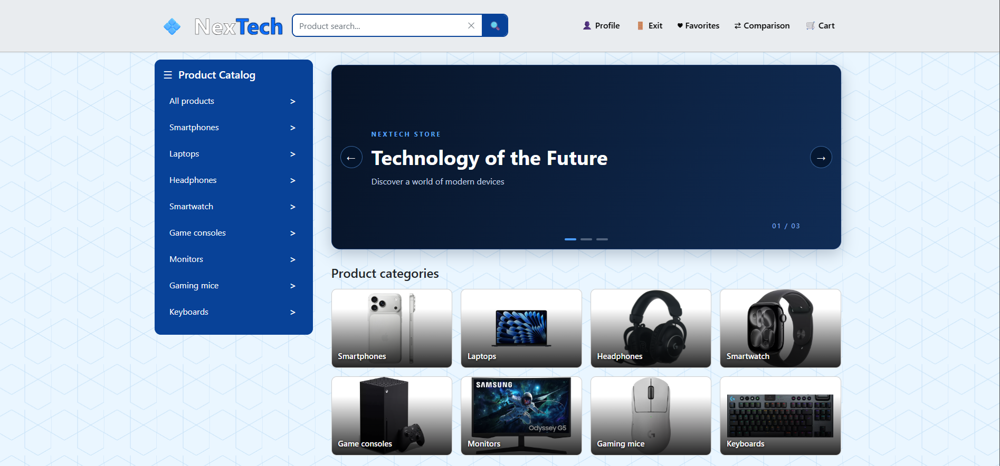
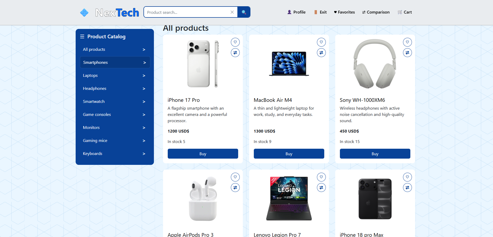
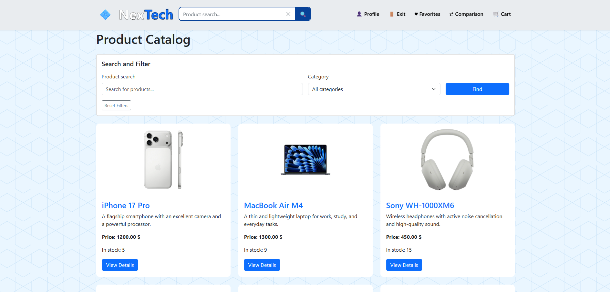
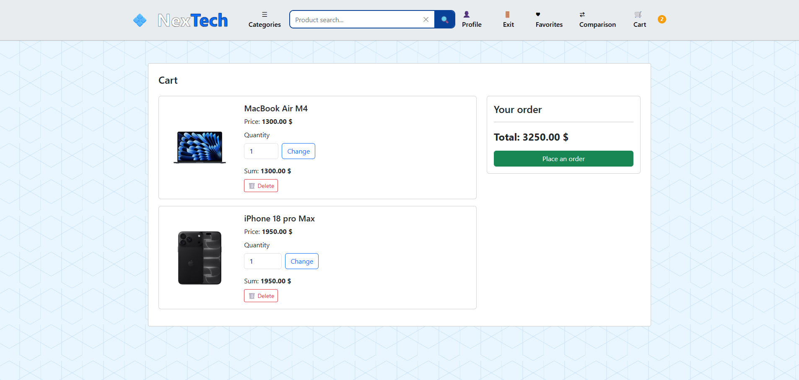
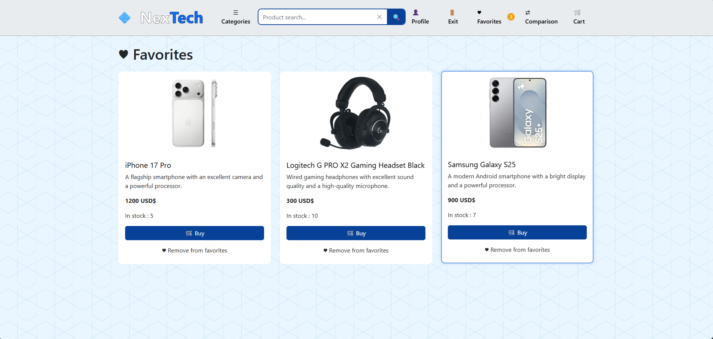
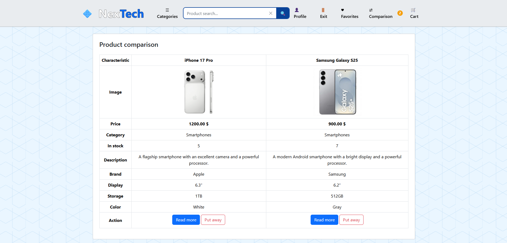
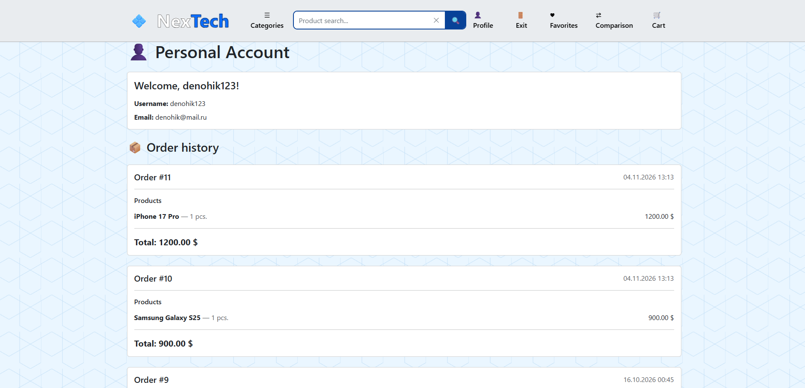
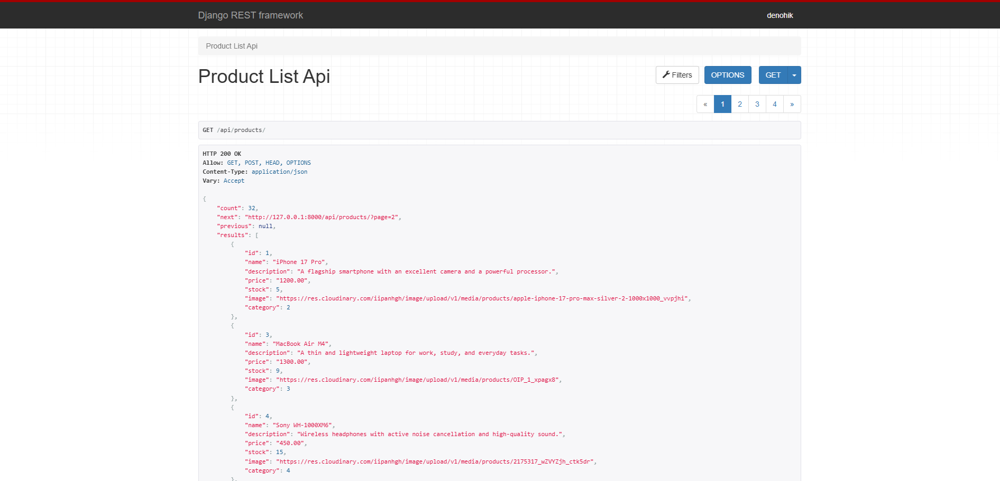
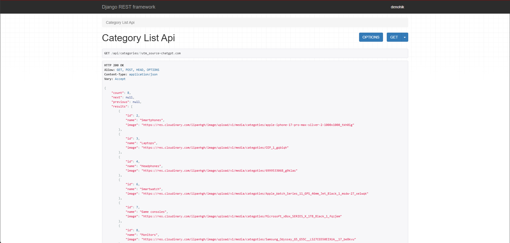

# NexTech — Django E-commerce Store

A full-stack e-commerce web application built with Python and Django. The project includes product catalog management, shopping cart functionality, user accounts, order processing, and a REST API.

**Live Demo:** [https://nextech-django-store.onrender.com]

**GitHub Repository:** [https://github.com/Denohik147/Nextech-Django-store]

## Screenshots

### Home Page


### Product Catalog


### Product Details


### Shopping Cart


### Favorites


### Product Comparison


### User Profile


### REST API — Products


### REST API — Categories


## Features

### Storefront
- Product catalog with category filtering.
- Product search by name.
- Product detail pages with descriptions, prices, images, and specifications.
- Shopping cart with quantity management and automatic total calculation.
- Stock availability validation.
- User registration, login, and logout.
- User profile and order history.
- Favorites and product comparison.

### Order Management
- Checkout process.
- Order creation linked to authenticated users.
- Order items with product quantities and prices.
- Order management through Django Admin.

## REST API

Built with Django REST Framework.

### Products

| Method | Endpoint | Description |
|---|---|---|
| GET | `/api/products/` | List all products |
| GET | `/api/products/1/` | Retrieve product details |
| POST | `/api/products/` | Create a product (admin only) |
| PUT / PATCH | `/api/products/1/` | Update a product (admin only) |
| DELETE | `/api/products/1/` | Delete a product (admin only) |

### Categories

| Method | Endpoint | Description |
|---|---|---|
| GET | `/api/categories/` | List all categories |
| GET | `/api/categories/1/` | Retrieve category details |
| POST | `/api/categories/` | Create a category (admin only) |
| PUT / PATCH | `/api/categories/1/` | Update a category (admin only) |
| DELETE | `/api/categories/1/` | Delete a category (admin only) |

### API Features
- Public read access.
- Admin-only write operations.
- Category filtering (`?category=1`).
- Search by product name and description (`?search=iphone`).
- Pagination (10 items per page).
- 5-minute response caching.
- Cache invalidation after data modifications.

## Tech Stack

| Technology | Purpose |
|---|---|
| Python 3.14 | Programming language |
| Django 6.1 | Web framework |
| Django REST Framework | REST API |
| PostgreSQL (Neon) | Production database |
| SQLite | Local development database |
| Cloudinary | Product and category image storage |
| Redis | Caching |
| WhiteNoise | Static file serving |
| Gunicorn | WSGI application server |
| Docker | Containerization |
| Docker Compose | Local multi-container environment |
| Render | Application deployment |
| Resend | Email delivery through HTTP API |

## Project Structure

```text
PythonProject/
│
├── api/
│   ├── migrations/
│   ├── serializers.py
│   ├── urls.py
│   ├── views.py
│   └── tests.py
│
├── online_store/
│   ├── settings.py
│   ├── urls.py
│   ├── asgi.py
│   └── wsgi.py
│
├── shop/
│   ├── migrations/
│   ├── templates/
│   │   └── shop/
│   ├── admin.py
│   ├── context_processors.py
│   ├── forms.py
│   ├── models.py
│   ├── signals.py
│   ├── views.py
│   └── tests.py
│
├── docs/
│   └── screenshots/
│
├── Dockerfile
├── docker-compose.yml
├── requirements.txt
├── manage.py
└── README.md
```

## Application Architecture

The project is organized into two main Django applications: `shop` and `api`.

### Shop Application

The `shop` application handles the main e-commerce functionality:

- **Models:** define database entities such as products, categories, orders, favorites, comparisons, and user profiles.
- **Views:** implement business logic for the storefront, product catalog, shopping cart, checkout, and user accounts.
- **Templates:** render HTML pages for the user interface.
- **Forms:** handle user registration and authentication.
- **Session-based cart:** stores cart items in the user's Django session.

### API Application

The `api` application provides a REST API built with Django REST Framework.

- **Views:** handle API requests using generic class-based views.
- **Serializers:** convert Django model instances into JSON and validate incoming data.
- **URLs:** define endpoints for products and categories.
- **Permissions:** allow public read access and restrict create, update, and delete operations to administrators.
- **Filtering and search:** support product filtering by category and searching by name or description.
- **Caching:** use Redis to cache API responses for 5 minutes. The cache is cleared after data modifications.

### Application Interaction

The main URL configuration (`online_store/urls.py`) routes requests to the appropriate application:

- Storefront requests are handled by the `shop` application.
- API requests under `/api/` are routed to the `api` application.
- Both applications use shared Django models and the Django ORM to interact with the database.

### Infrastructure

- **PostgreSQL (Neon):** production database.
- **SQLite:** local development database.
- **Redis:** API response caching.
- **Cloudinary:** product and category image storage.
- **Django Admin:** administrative interface for managing store data.

## Data Models

The `shop` application contains the following models:

- **Category** — product categories.
- **Product** — products, prices, stock quantities, images, and category relationships.
- **ProductParameter** — additional product specifications.
- **Order** — customer orders.
- **OrderItem** — individual products included in an order.
- **Favorite** — products saved by users.
- **Comparison** — products selected for comparison.
- **UserProfile** — additional user profile information.

## Local Development

### 1. Clone the repository

```bash
git clone https://github.com/Denohik147/Nextech-Django-store.git
cd Nextech-Django-store
```

### 2. Create and activate a virtual environment

Windows PowerShell:

```powershell
python -m venv .venv
.\.venv\Scripts\Activate.ps1
```

### 3. Install dependencies

```powershell
pip install -r requirements.txt
```

### 4. Configure environment variables

Create a `.env` file in the project root:

```env
SECRET_KEY=your-secret-key
DEBUG=True
ALLOWED_HOSTS=localhost,127.0.0.1

USE_NEON=False
CLOUDINARY_CLOUD_NAME=your-cloud-name
CLOUDINARY_API_KEY=your-api-key
CLOUDINARY_API_SECRET=your-api-secret

REDIS_URL=redis://127.0.0.1:6379/1

RESEND_API_KEY=your-resend-api-key
DEFAULT_FROM_EMAIL=onboarding@resend.dev
```

The local configuration uses SQLite by default.

Cloudinary and Resend credentials are required for image storage and email delivery. The application also expects `RESEND_API_KEY` to be configured.

Redis must be running locally. If you use Docker Compose to start Redis while running Django directly on Windows, use:

```powershell
docker compose up -d redis
```

The local Django application connects to Redis through `127.0.0.1`.

### 5. Apply database migrations

```powershell
python manage.py migrate
```

### 6. Create an administrator account

```powershell
python manage.py createsuperuser
```

### 7. Start the development server

```powershell
python manage.py runserver
```

Open the application:

[http://127.0.0.1:8000/]

Django Admin:

[http://127.0.0.1:8000/admin/]

## Docker Compose

The project includes a Docker Compose configuration for running the Django application and Redis.

Before starting the containers, configure the following Redis address in `.env`:

```env
REDIS_URL=redis://redis:6379/1
```

Then run:

```powershell
docker compose up --build
```

The application will be available at:

[http://localhost:8000/]

Make sure the `.env` file exists in the project root before starting the containers.

## Production Deployment

The application is deployed on Render using Docker.

Production infrastructure:

- **Render** — application hosting.
- **Neon** — PostgreSQL database.
- **Cloudinary** — persistent image storage.
- **Redis** — application caching.
- **Resend** — email delivery.
- **WhiteNoise** — static file serving.

Production configuration is managed through environment variables. Sensitive credentials are not stored in the repository.

## Author

**Daniil Goncearenco**

GitHub: [https://github.com/Denohik147]